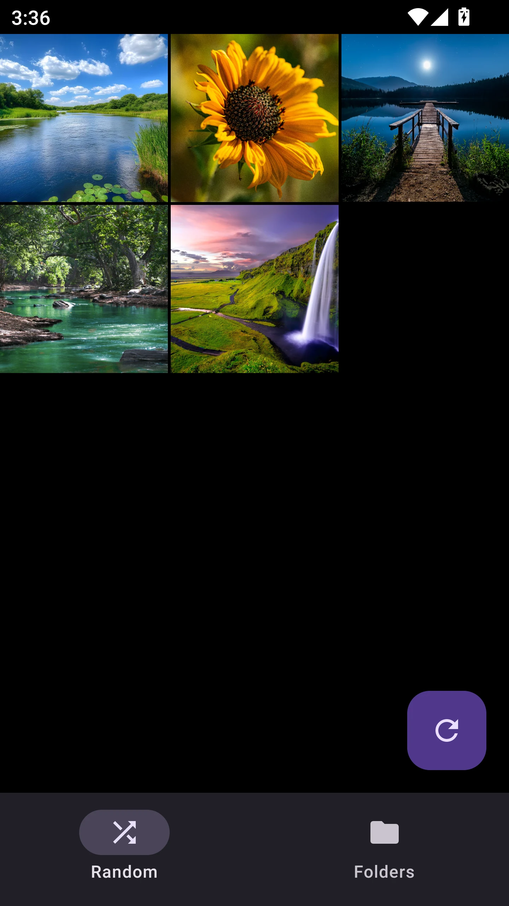
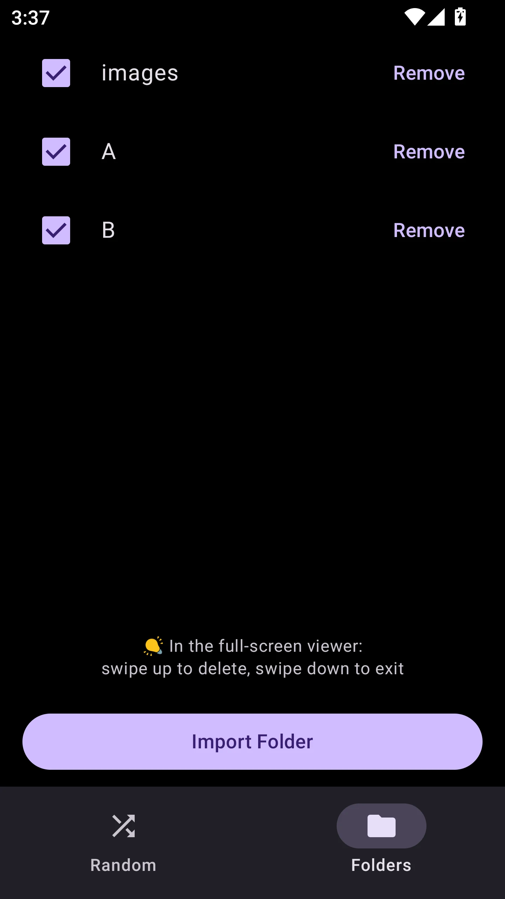

<h1 align="center">Random Gallery</h1>

  <strong>Shuffle. Browse. Manage.</strong> 
  A random-browsing photo gallery for Android.

  <a href="#download">Download APK</a> ·
  <a href="#features">Features</a> ·
  <a href="#screenshots">Screenshots</a> ·
  <a href="#how-it-works">How It Works</a>

---

## Download

> 📦 Latest APK: [Releases](../../releases/latest)

Download the APK, install it on your Android device, and start browsing.

## Features

| | |
| --- | --- |
| 🔀 **Random shuffle** | Browse photos from your selected folders in shuffled order |
| 📁 **Folder import** | Pick folders from internal storage using Android's folder picker |
| ✅ **Selective browsing** | Toggle imported folders on or off without removing them |
| 🔍 **Full-screen viewer** | Pinch to zoom and swipe between images |
| 🗑️ **Trash** | Move images to Android's media trash with confirmation |
| 📤 **Share & open** | Share images or open them with another compatible app |
| ✏️ **Image actions** | View details, edit with another app, or set an image using a compatible app |
| 📂 **Folder actions** | Show an image's folder or exclude its folder from browsing |
| 🔄 **Adaptive orientation** | Use Random Gallery in portrait or landscape, including large-screen devices |

## Screenshots

  
  

## How It Works

1. Open the **Folders** tab and tap **Import Folder** to choose a photo folder.
2. Use the checkboxes to choose which imported folders are included.
3. Open the **Random** tab to browse the included photos in shuffled order.
4. Tap ↻ to reshuffle the current collection.
5. Tap a thumbnail to open the full-screen viewer.
6. Tap the image for viewer controls, or swipe up to delete and swipe down to exit.

Only folders inside internal storage, such as Pictures and DCIM, are currently supported.

Images are indexed through Android MediaStore and accessed from their source folders through Android's Storage Access Framework. Random Gallery never copies or moves your images. Media access is requested as required by the Android version; on Android 14 and newer, granting access to selected photos limits Random Gallery to those authorised images within your imported folders.

## Development

Pull requests are validated automatically with Android tests, lint, Kotlin style checks, a debug build, dependency review, and CodeQL analysis. Changes to GitHub Actions workflows are also checked with actionlint.

The combined **PR Gate** must pass before a pull request can merge into `muffin-fork`.
